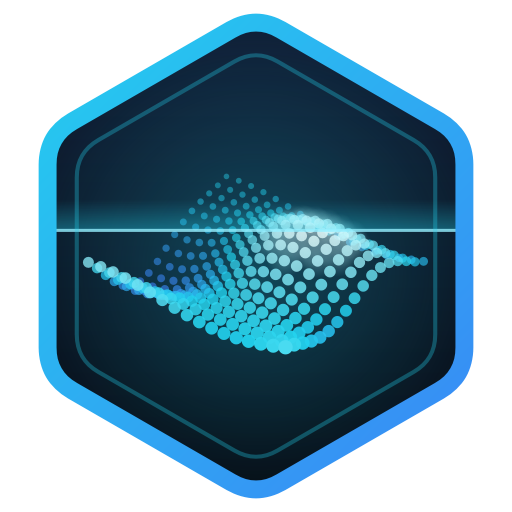
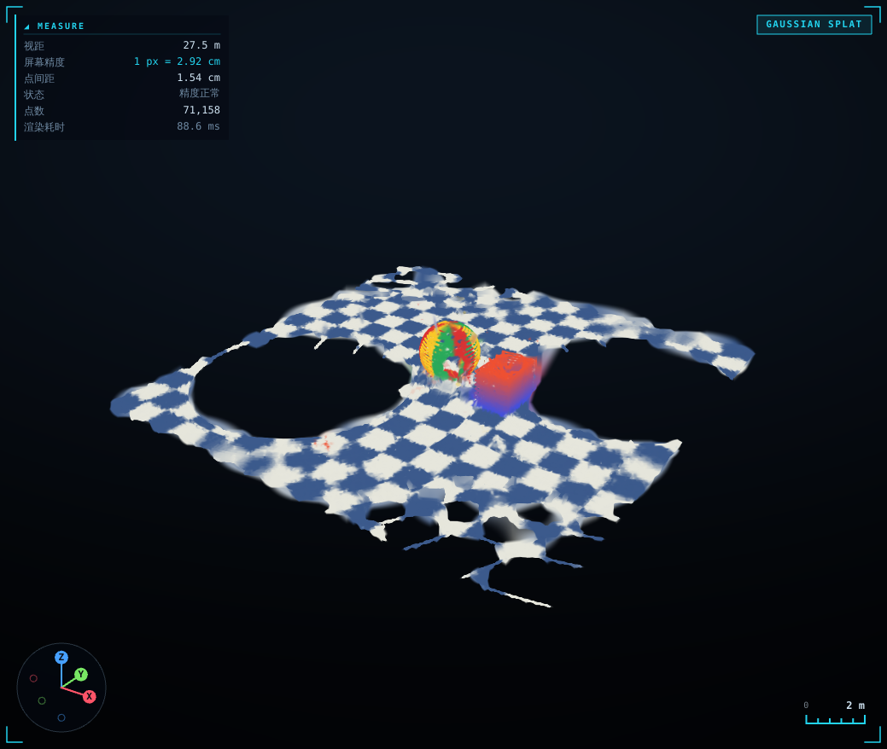
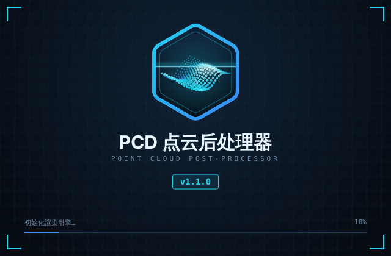
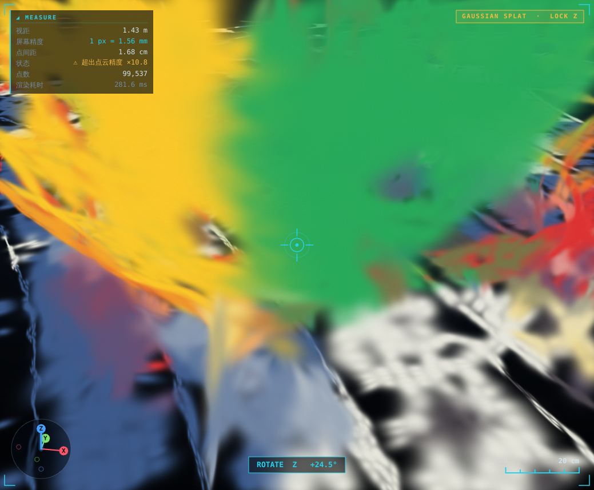
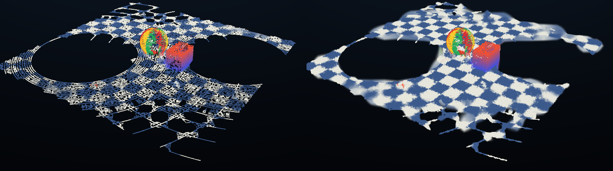

<div align="center">



# PCD 点云后处理器

**Point Cloud Post-Processor** — 查看 `.pcd` 点云地图，一键去噪、补点、相机着色，以高斯泼溅方式渲染成连续表面


[功能](#-功能) · [快速开始](#-快速开始) · [操作](#-操作) · [数据准备](#-数据准备) · [原理](#-原理) · [打包](#-打包成-exe)



</div>

---

## ✨ 功能

| | |
|---|---|
| 🖱️ **三轴旋转 + 平移** | 左键按 X / Y / Z 轴旋转（可锁定单轴），右键拖曳平移，滚轮平滑缩放，标准视角带过渡动画 |
| 📏 **实时精度 HUD** | 屏幕精度（1 px 对应多长）、点间距、视距、比例尺；单位在 µm / mm / cm / m / km 间自动切换；放大超出点云精度时给出提示 |
| 🧹 **自动后处理** | 统计滤波去噪 → 自动估计扫描线间距并补点 → 邻域插值加密 |
| 📷 **相机着色** | 支持 COLMAP 工程或 JSON 标定；多视角加权融合，带遮挡判断，支持针孔 / OpenCV 畸变 / 鱼眼 |
| 🫧 **高斯泼溅渲染** | 每个点按局部表面估计 3D 高斯椭球，使用与 3DGS 相同的 EWA 投影，从后往前做 alpha 混合 |
| 🧩 **连续表面** | 未被拍到的点从邻域补色，屏幕空间 pull-push 填洞，表面不再缺一块少一块 |
| 💾 **导出** | 保存处理后的 PCD；导出标准 3DGS `.ply`（可在 SuperSplat 等查看器中打开，也可作为 3DGS 训练的初始化） |
| 📂 **格式** | PCD ascii / binary / binary_compressed（内置 LZF 解压），字段 `rgb` / `rgba` / `r g b` / `intensity` |

<table>
<tr>
<td width="50%"><p align="center"><sub>启动画面</sub></p></td>
<td width="50%"><p align="center"><sub>放大到超出点云精度、锁定 Z 轴旋转时的 HUD</sub></p></td>
</tr>
</table>

<p align="center">
<br>
<sub>左：原始稀疏扫描线　右：补点 + 相机着色 + 填洞之后</sub>
</p>

## 🚀 快速开始

```bash
git clone https://github.com/strongthenly/pcd-.git
cd pcd-
pip install -r requirements.txt

python main.py                                   # 启动后拖入 .pcd
python main.py map.pcd --cameras path/to/colmap  # 直接打开点云 + 相机
```

没有数据时，可以先生成一份演示场景：

```bash
python tools/make_demo.py demo_data
python main.py demo_data/scene.pcd --cameras demo_data
```

<details>
<summary>命令行参数</summary>

| 参数 | 说明 |
|---|---|
| `pcd` | 要打开的点云文件 |
| `--cameras` | COLMAP 工程文件夹或相机 JSON |
| `--densify N` | 加密轮数（0–4） |
| `--mode splat\|points` | 渲染模式 |
| `--axis x\|y\|z` | 锁定左键旋转轴 |
| `--no-splash` | 不显示启动画面 |
| `--screenshot out.png` | 处理完成后截图并退出（用于测试） |

</details>

## 🎮 操作

| 操作 | 效果 |
|---|---|
| 左键拖动 | 水平：绕 Z 轴旋转；垂直：俯仰 |
| `Shift` + 左键 | 绕 Y 轴旋转 |
| 按住 `X` / `Y` / `Z` + 左键 | 只绕该轴旋转（面板中也可以固定锁定） |
| 右键 / 中键拖动 | 平移 |
| 滚轮 | 平滑缩放 |
| 左键双击 | 把点击处的点设为旋转中心 |
| `R` / `F` / `H` | 重置视角 / 适配全图 / 显示或隐藏 HUD |

### HUD 读数

| 项目 | 含义 |
|---|---|
| 屏幕精度 | 旋转中心深度处，1 个屏幕像素对应的实际长度 |
| 点间距 | 最近邻距离的中位数，即点云本身的分辨率 |
| 状态 | `精度正常` / `接近点云精度` / `⚠ 超出点云精度 ×N` |
| 比例尺 | 右下角，取 1、2、5 × 10ⁿ |

> PCD 坐标默认按**米**处理。如果数据是厘米或毫米，在「显示 → 数据单位」中切换。

## 📦 数据准备

| 数据 | 必需？ | 说明 |
|---|:---:|---|
| 点云 `.pcd` | ✅ | 至少包含 `x y z`；有 `intensity` / `rgb` 更好 |
| 相机图像 | 着色用 | 与点云覆盖同一区域，视角越多越完整 |
| 相机内参 | 着色用 | `fx fy cx cy`、分辨率，以及畸变系数（如有） |
| 图像位姿 | 着色用 | COLMAP 工程 / 每张图的相机位姿 / 雷达位姿 + 雷达到相机外参，三选一 |

> [!IMPORTANT]
> 位姿与点云必须在**同一坐标系、同一单位**下，图像时间戳要与位姿对齐，否则颜色会错位。相机坐标系采用 OpenCV 约定（x 右、y 下、z 前）。

<details>
<summary><b>COLMAP 目录结构</b></summary>

```
project/
├── images/
└── sparse/0/      cameras.bin|txt  images.bin|txt
```

支持 `PINHOLE`、`SIMPLE_PINHOLE`、`SIMPLE_RADIAL`、`RADIAL`、`OPENCV`、`FULL_OPENCV`、`OPENCV_FISHEYE` 等相机模型。

</details>

<details>
<summary><b>JSON 格式（激光雷达 + 相机标定）</b></summary>

```jsonc
{
  "images_dir": "images",
  "intrinsics": {
    "width": 1920, "height": 1080,
    "fx": 1000, "fy": 1000, "cx": 960, "cy": 540,
    "dist": [0, 0, 0, 0, 0],          // OpenCV: k1 k2 p1 p2 k3；鱼眼: k1~k4
    "model": "opencv"                 // pinhole | opencv | fisheye
  },
  "T_cam_from_lidar": [[1,0,0,0],[0,1,0,0],[0,0,1,0],[0,0,0,1]],
  "frames": [
    { "image": "000001.jpg", "T_world_from_lidar": [[/* 4x4 */]] },  // SLAM 雷达位姿
    { "image": "000002.jpg", "T_world_from_cam":   [[/* 4x4 */]] },  // 或直接给相机位姿
    { "image": "000003.jpg", "T_cam_from_world":   [[/* 4x4 */]] }
  ]
}
```

- 内参也可以写成 `"K": [[fx,0,cx],[0,fy,cy],[0,0,1]]`。
- 每帧可以有自己的 `"intrinsics"`，用于多相机。
- 图像分辨率与 `width`/`height` 不一致时，内参会自动按比例缩放。

</details>

只有点云时也能使用：去噪、补点、加密、高斯渲染都可以进行，颜色按高度、强度或原始 RGB 显示。

## 🔬 原理

```
PCD ─► 统计滤波去噪 ─► 扫描线空隙填补 ─► 中点加密 ─► 局部 PCA 高斯 ─┐
                                                                    ├─► 排序 + EWA 泼溅 ─► pull-push 填洞 ─► 屏幕
相机图像 + 位姿 ─► 投影 + z-buffer 遮挡 ─► 多视角加权融合 ─► 邻域补色 ─┘
```

<details>
<summary>展开细节</summary>

- **空隙填补**：用体素计数反推扫描线间距 `G ≈ V²/(s·n)`。若 `G` 明显大于点间距 `s`，在 `max_gap/2.5` 的体素粗结构上按局部切平面的角度顺序构建三角形，只保留边长不超过 `max_gap` 的三角形，并在其中按重心坐标撒点。原始点全部保留。
- **高斯估计**：用 12 近邻做 PCA。主轴尺度取局部点间距，法向方向压薄。平面区域得到贴合表面的圆盘，线状结构得到细长椭球。
- **渲染**：顶点着色器把 3D 协方差经雅可比投影成 2D 圆锥，片元着色器计算高斯 α 值。每帧按视线深度做 uint16 基数排序（只与旋转有关），从后往前用预乘 α 混合。
- **相机着色**：每个视角先构建粗网格 z-buffer（3×3 最小值膨胀）判断遮挡，然后做双线性采样，权重为 `(1/深度 · 中心权重)²`，以突出最佳视角。
- **连续表面**：未被拍到的点从 8 个已着色邻点按距离加权补色。渲染时先输出到离屏纹理并生成 mip 金字塔：第 L 级是 2^L 像素块的覆盖加权平均色，未覆盖像素从细到粗逐级补齐。只有当周围覆盖率足够高（即洞被表面包围）时才补，物体边缘不会糊到背景上。

</details>

## 🛠 打包成 exe

**本地（Windows）**：安装 64 位 Python 3.9–3.12（勾选 *Add python.exe to PATH*），双击 `build.bat`，输出 `dist/PCDViewer.exe`。

**GitHub Actions**：每次 push 都会触发 [`.github/workflows/build-windows.yml`](.github/workflows/build-windows.yml)，在 Actions 页面的 Artifacts 中下载 `PCDViewer-windows`。

修改 `logo.py` 后，运行 `python tools/make_icon.py` 重新生成 `assets/icon.ico`。版本号在 `version.py` 中修改。

## 📁 项目结构

```
├── main.py            入口、启动画面
├── app.py             主窗口、后台任务
├── gl_view.py         OpenGL 视图：点 / 高斯泼溅、填洞、HUD、交互
├── processing.py      去噪、空隙填补、加密、高斯估计、3DGS 导出
├── colorize.py        COLMAP / JSON 相机读取、投影着色、邻域补色
├── pcd_io.py          PCD 读写（含 LZF）
├── logo.py            Logo 与启动画面（代码绘制）
├── theme.py           科技风主题
├── version.py         版本号
├── tools/
│   ├── make_demo.py   生成演示数据
│   └── make_icon.py   导出图标
├── assets/            icon.ico、logo_512.png
├── build.bat          Windows 打包脚本
└── .github/workflows/ 自动打包
```

## ⚠️ 已知局限

- 高斯是根据几何直接构造的，**没有**做 3DGS 的梯度优化训练，因此没有随视角变化的高光。
- 雷达完全没扫到的大片区域不会被凭空补出来。
- 需要支持 OpenGL 3.3 的显卡；远程桌面下可能只有软件 OpenGL。

## 🗺 Roadmap

- [ ] FAST-LIVO / R3LIVE 位姿与标定文件一键转换
- [ ] 基于 CUDA 的 3DGS 优化训练
- [ ] 测距 / 截面 / 框选裁剪工具
- [ ] 大规模点云八叉树 LOD 流式加载
